# SchoolNet — Backend

An e-learning platform API: teachers publish video courses, students pay to subscribe and watch.

Built with **ASP.NET Core 8**, **SQL Server** (raw ADO.NET + stored procedures), **Stripe** for payments and **MUX** for video.

> **Project status:** SchoolNet is a work in progress. It runs end to end for the main flows described below, but a lot of the project is still not done. Treat it as a learning project and a base to build on, not as production software.

The matching React frontend lives in its own repository: **schoolnet-FE**.

---

## Contents

- [What it does](#what-it-does)
- [Architecture](#architecture)
- [Class diagrams](#class-diagrams)
- [Sequence diagrams](#sequence-diagrams)
- [Database](#database)
- [API reference](#api-reference)
- [Getting started](#getting-started)
- [Project structure](#project-structure)

---

## What it does

| Role | Can do |
|---|---|
| **Teacher** | Sign up (a Stripe Connect account is created for them), create courses, add video lessons, upload videos |
| **Student** | Sign up, browse courses, pay for a course through Stripe Checkout, watch the videos of courses they paid for |
| **Anyone** | Browse the course list and see the lesson titles of a course |

---

## Architecture

Three layers, each one a separate C# project. A fourth project, `SharedDTOs`, holds the data shapes every layer shares.

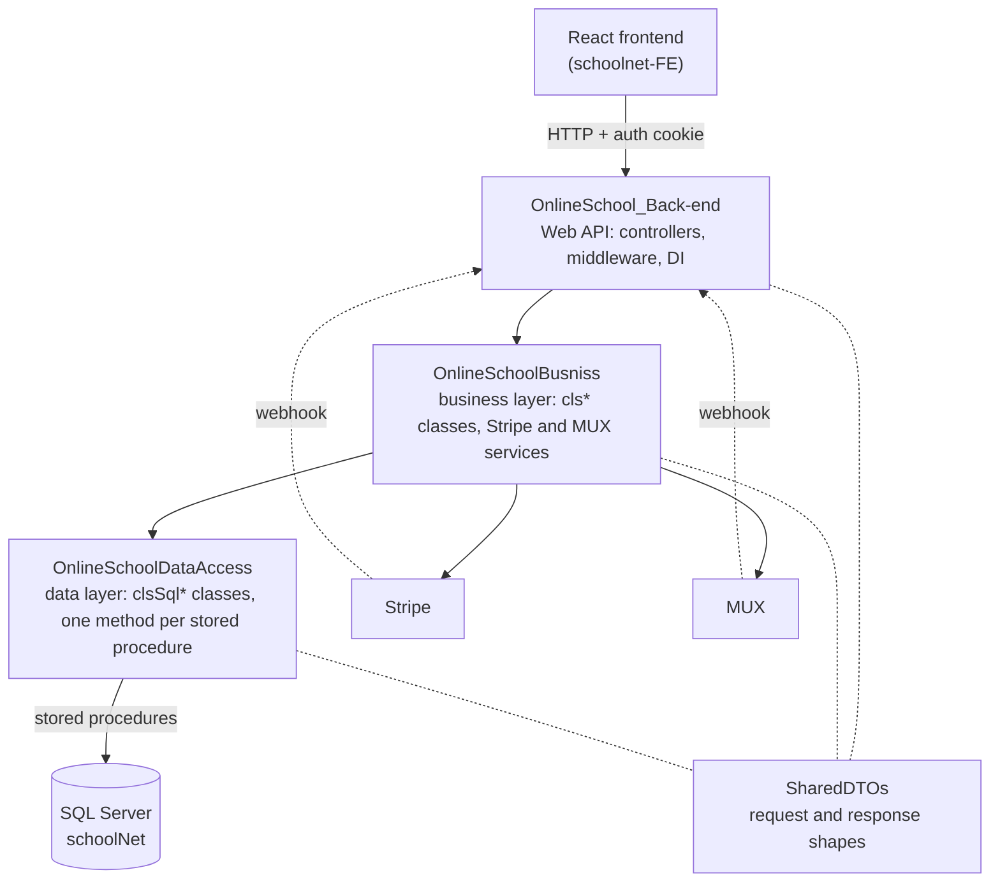

**Rule of thumb:** a controller never touches SQL, and the data layer never knows about HTTP.

### Patterns used

| Pattern | Where |
|---|---|
| Active Record | `clsCourse`, `clsStudent`, `clsTeacher`, `clsCourseContent`, … each object has its own `Find()` and `Save()` |
| Static data-access classes | `clsSql*Data` wrap `SqlCommand` calls to stored procedures |
| Options pattern | `clsStripeModel` and `clsMUXSigningServiceModel` are bound from configuration |
| Named `HttpClient` | `"muxService"` is pre-configured with MUX credentials |
| Cookie authentication | `401` / `403` status codes instead of login redirects (suits a SPA) |
| Custom middleware | `muxTraficValidatorMiddleware` verifies MUX webhook signatures |

---

## Class diagrams

### Domain classes (business layer)

The `cls*` classes are the core of the app. A `Student` or `Teacher` *has a* `Person` (the personal details), and a course is linked to its teachers through `CourseHandlers`.

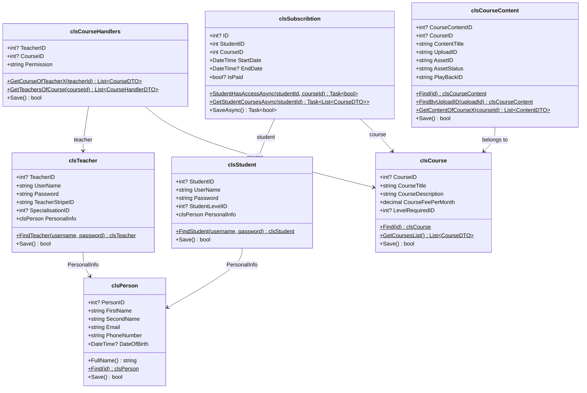

### Services and the layers around them

Controllers depend on `IAuthService` and on the domain and service classes. External providers (Stripe, MUX) are wrapped in their own service classes so controllers stay thin.

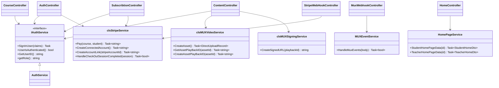

---

## Sequence diagrams

### 1. Login

The server keeps the session in an `HttpOnly` cookie. The cookie carries two claims: `UserID` and `User_Role` (`student` or `teacher`). Every protected endpoint reads them through `IAuthService`.

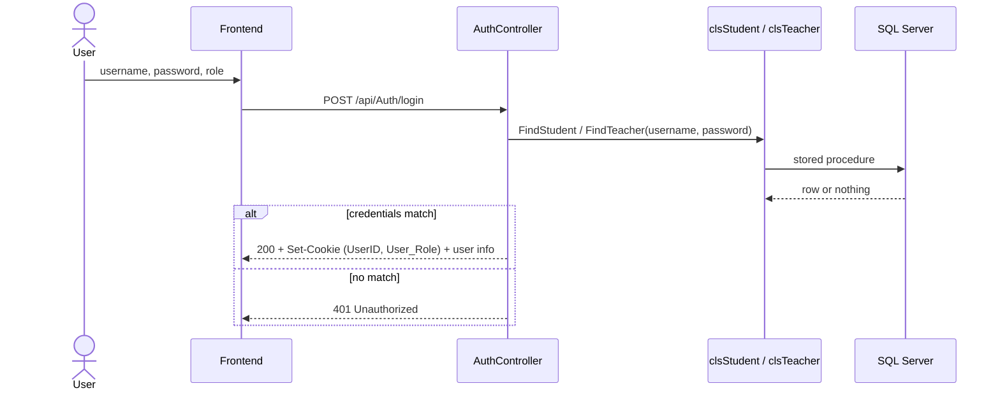

### 2. Teacher sign-up (with Stripe account)

A teacher needs a Stripe Connect account so they can be paid later, so one is created during sign-up and its id is stored on the teacher.

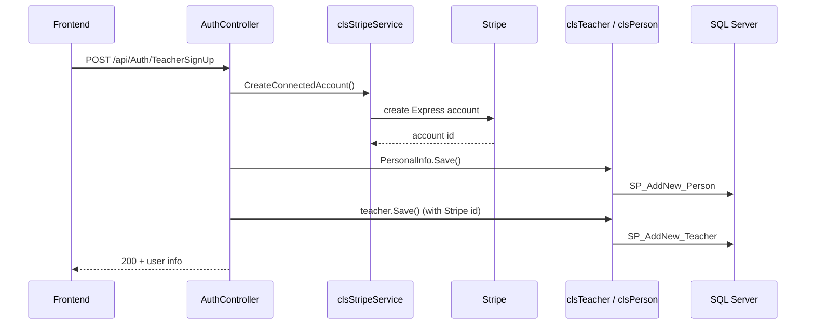

### 3. Create a course

Only teachers can create courses. The creating teacher automatically becomes the course's `admin` through a `CourseHandler` record.

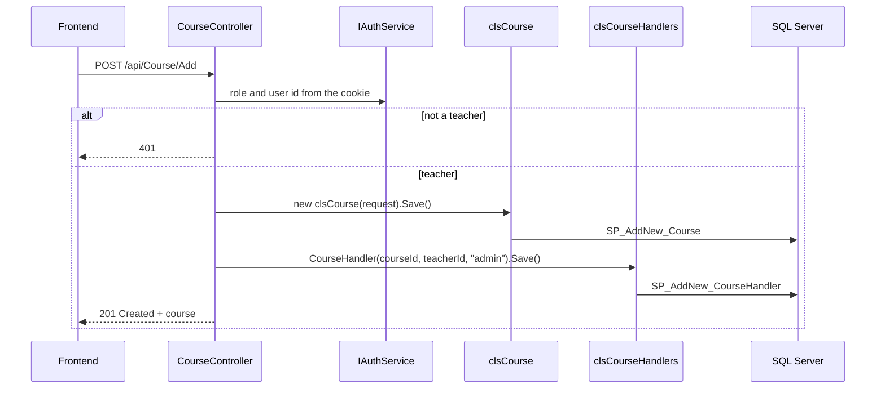

### 4. Pay for a course (Stripe Checkout)

The student is **not** subscribed when they click pay. The subscription is only created later, when Stripe confirms the payment through a webhook. The course and student ids travel inside the checkout session metadata.

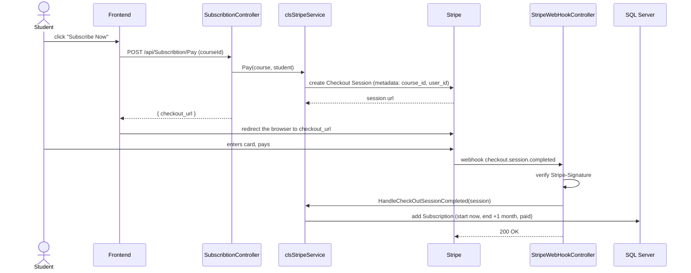

### 5. Upload a lesson video (MUX direct upload)

Video files never pass through this API. The API only asks MUX for a one-time upload URL, and the browser sends the file straight to MUX. MUX then tells the API what happened through webhooks.

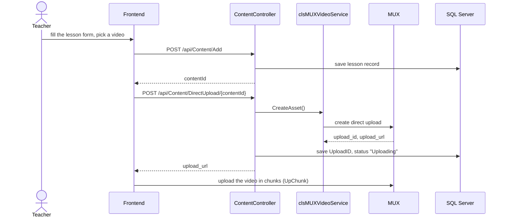

### 6. MUX webhooks (processing finished)

The lesson record is matched to the MUX event through the `UploadID` that was saved in the previous step. A middleware verifies that the request really came from MUX before the controller sees it.

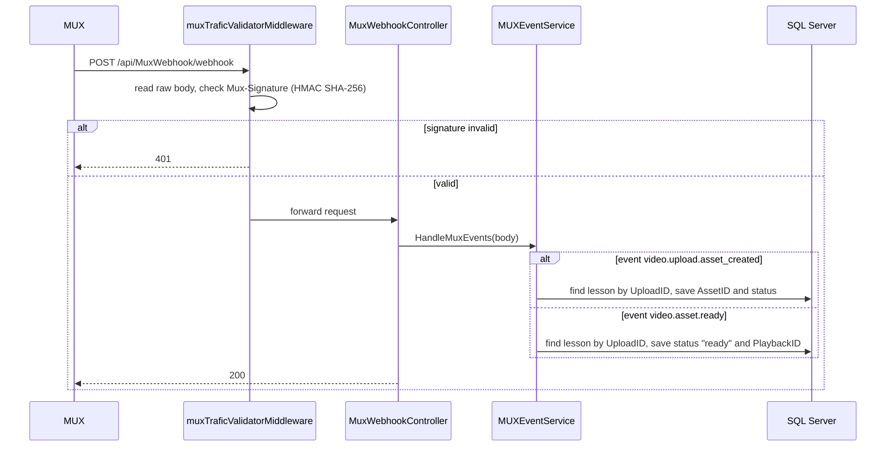

### 7. Watch a lesson (signed playback URL)

Playback URLs are signed with a private key and expire, so a video link can't simply be shared or hotlinked. Whether the viewer may watch is decided on the frontend using the role returned by `GET /api/Content/{courseId}` (`guest`, `new_student`, `subscribed_student`, `teacher`).

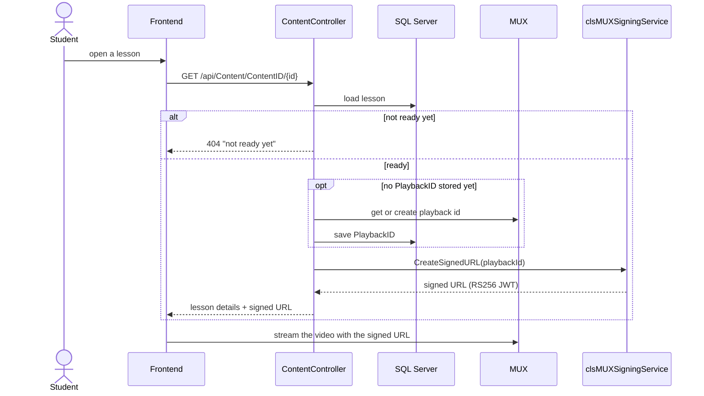

---

## Database

SQL Server, accessed with **raw ADO.NET and stored procedures** (no Entity Framework, no migrations). Each `.sql` file at the repo root creates the table and the stored procedures of one entity.

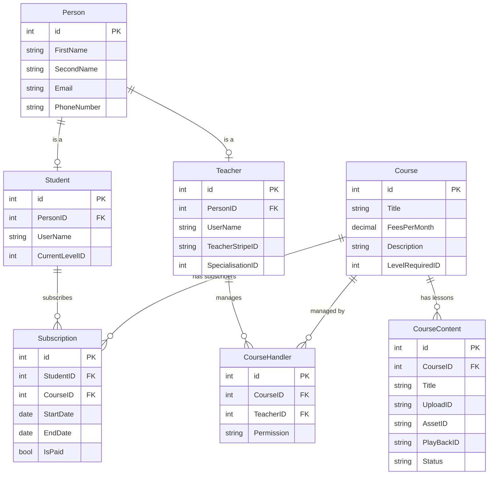

A database constraint guarantees exactly one `admin` per course (`UX_OneAdminPerCourse` on `CourseHandler`).

---

## API reference

Routes start with `/api`. "Cookie" means the caller must be logged in.

| Method | Route | Cookie | Purpose |
|---|---|---|---|
| `POST` | `/Auth/login` | no | Log in as student or teacher |
| `POST` | `/Auth/StudentSignUp` | no | Register a student |
| `POST` | `/Auth/TeacherSignUp` | no | Register a teacher (creates the Stripe account) |
| `GET` | `/Home` | yes | Dashboard data for the logged-in student or teacher |
| `GET` | `/Course/All` | no | List all courses |
| `GET` | `/Course/{id}` | no | One course and its teachers |
| `GET` | `/Course/My` | yes | Courses the user teaches or is subscribed to |
| `POST` | `/Course/Add` | yes (teacher) | Create a course |
| `GET` | `/Content/{courseId}` | optional | Lessons of a course, plus the caller's role for that course |
| `GET` | `/Content/ContentID/{id}` | yes | One lesson with its signed video URL |
| `POST` | `/Content/Add` | yes | Create a lesson record |
| `POST` | `/Content/DirectUpload/{id}` | yes | Get a MUX upload URL for a lesson |
| `POST` | `/Subscribtion/UserHasAccess` | yes | Does the student have access to a course? |
| `POST` | `/Subscribtion/Pay` | yes | Start a Stripe Checkout, returns `{ checkout_url }` |
| `POST` | `/StripeConnectedAccount/create-account-link` | yes | Stripe onboarding link for a teacher |
| `POST` | `/StripeWebHook` | no | Stripe webhook receiver |
| `POST` | `/MuxWebhook/webhook` | no | MUX webhook receiver (signature checked) |

With the API running in Development, the full interactive list is at `/swagger`.

---

## Getting started

### Prerequisites

- [.NET 8 SDK](https://dotnet.microsoft.com/download/dotnet/8.0)
- SQL Server (local, or the Docker image `mcr.microsoft.com/mssql/server`)
- A [Stripe](https://stripe.com) account (test mode is fine)
- A [MUX](https://mux.com) account with an API access token and a signing key

### 1. Create the database

Create a database called `schoolNet`, then run these scripts in this order:

```
Person.sql
Student.sql
Teacher.sql
Course.sql
CourseHandler.sql
CourseContent.sql
Subscription.sql
```

### 2. Configure secrets

Settings are read from `appsettings.json`, and any value can be overridden with an environment variable or with [.NET user secrets](https://learn.microsoft.com/aspnet/core/security/app-secrets). **Never commit real keys.** Use placeholders in `appsettings.json` and put the real values in user secrets:

```bash
cd OnlineSchool_web_Back-end-main
dotnet user-secrets init
dotnet user-secrets set "ConnectionStrings:DefaultConnection" "Server=localhost,1433;Database=schoolNet;User Id=sa;Password=<your-password>;TrustServerCertificate=True"
dotnet user-secrets set "Stripe:privateKey" "sk_test_..."
dotnet user-secrets set "Stripe:WebHookKey" "whsec_..."
dotnet user-secrets set "MUXVideoService:muxTokenID" "..."
dotnet user-secrets set "MUXVideoService:muxTokenSecret" "..."
dotnet user-secrets set "MUXVideoService:WebHookKey" "..."
dotnet user-secrets set "MUXSigningService:KeyID" "..."
dotnet user-secrets set "MUXSigningService:SecretKey" "<base64 private key>"
```

### 3. Run

```bash
cd OnlineSchool_web_Back-end-main
dotnet restore
dotnet run
```

- Swagger UI: `/swagger` on the URL printed in the console
- CORS allows the React dev server at `http://localhost:3000`

### 4. Test the webhooks locally

Stripe and MUX need a public URL to reach your machine. Use the [Stripe CLI](https://stripe.com/docs/stripe-cli) (`stripe listen --forward-to localhost:<port>/api/StripeWebHook`) and a tunnel such as `ngrok` for MUX.

---

## Project structure

```
SchoolNet/
├── SchoolNet.slnx
├── OnlineSchool_web_Back-end-main/     Web API (entry point)
│   ├── Controllers/                    one controller per feature
│   ├── Services/                       IAuthService, HomePageService
│   ├── Middlewares/                    request logging, MUX signature check
│   ├── Program.cs                      DI setup and middleware pipeline
│   └── appsettings.json
├── OnlineSchoolBusniss/                business layer
│   ├── cls*.cs                         domain classes (Course, Student, ...)
│   ├── clsStripeService.cs             payments and Connect accounts
│   ├── clsMUXVideoService.cs           direct upload and playback ids
│   ├── clsMUXSigningService.cs         signed playback URLs
│   └── MUXEventService.cs              MUX webhook handling
├── OnlineSchoolDataAccess/             data layer
│   └── clsSql*Data.cs                  one class per table, one method per stored procedure
├── SharedDTOs/                         request and response objects
└── *.sql                               tables and stored procedures
```

### Naming

The code uses `cls` for classes and `clsSql` for data-access classes. That is the project's house style, so new code follows it.
